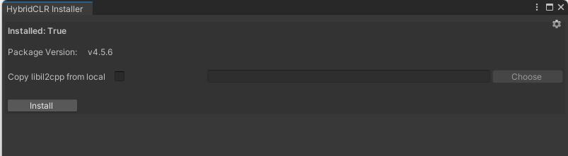
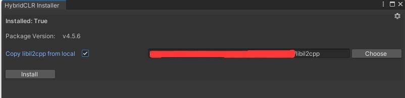

# hybridclr Package手册

`com.code-philosophy.hybridclr`是一个Unity package，它提供了HybridCLR所需的Editor工作流工具脚本及Runtime脚本。借助
com.code-philosophy.hybridclr提供的工作流工具，打包一个支持HybridCLR热更新功能的App变得非常简单。hybridclr_unity包主要包含以下内容：

- Editor相关脚本
- Runtime相关脚本
- AI Skills，位于 `Data~/skills`，见 [AI Skills](./ai-skills.md)

:::caution
v3.0.0 之前的包名叫 `com.focus-creative-games.hybridclr_unity`。
:::

:::tip
自 **v9.0.0** 起，本地数据目录固定为 `{project}/Library/HybridCLR`（热更新 dll、裁剪后的 AOT dll、本地 il2cpp 等）。Settings 中已不再提供可配置的输出根目录字段。
:::

## HybridCLR菜单介绍

以下子菜单均在菜单栏的`HybridCLR`菜单下，出于简化，我们下面提到子菜单时不再包含HybridCLR。

### Installer...

详细文档见[安装HybridCLR](./install.md)。

Installer是一个方便的安装器，帮助正确设置本地il2cpp目录，其中包含替换`Library/HybridCLR/LocalIl2CppData-{platform}/il2cpp/libil2cpp`目录为HybridCLR修改版本。


安装界面中 `安装状态：已安装|未安装` 指示是否完成HybridCLR初始化。点击安装，如成功，则最后会显示`安装成功`日志，并且安装状态切换为`已安装`，否则请检查错误日志。

:::tip
如果已经安装HybridCLR，点击安装按钮会安装最新的HybridCLR版本的libil2cpp。
:::

com.code-philosophy.hybridclr中 `Data~/hybridclr_version.json` 文件中已经配置了当前package版本对应的兼容 hybridclr及il2cpp_plus的 **tag**，
Installer会安装配置中指定的版本，不再支持自定义待安装的版本。

配置类似如下：

```json
{
    "versions": [
    {
        "unity_version":"2022.3.x",
        "hybridclr" : { "tag":"v9.0.1"},
        "il2cpp_plus": { "tag":"v2022.3.x-9.0.1"}
    },
    {
        "unity_version":"6000.0.x",
        "hybridclr" : { "tag":"v9.0.1"},
        "il2cpp_plus": { "tag":"v6000.0.x-9.0.1"}
    }
    ]
}
```

如果你一定要安装其他版本的hybridclr或il2cpp_plus，修改该配置文件中的`tag`为目标 tag 或分支名。



从版本2.3.1起新增支持直接从本地自己制作的包含hybridclr的libil2cpp目录复制安装。如果你网络不好，或者没有安装git导致无法从仓库远程下载安装，则可以先将 [il2cpp_plus](https://github.com/focus-creative-games/il2cpp_plus)和[hybridclr](https://github.com/focus-creative-games/hybridclr)下载到本地后，再根据[安装HybridCLR](./install.md)中**安装原理**小节的文档，由这两个仓库合并出含hybridclr的libil2cpp目录，接着在`Installer`安装界面中启用`从本地复制libil2cpp`选项，选择你制作的libil2cpp目录，再点击`安装`执行安装。如下图所示。



### Settings...

打开 Project Settings 中的 HybridCLR Settings 页面。字段说明见下文 [HybridCLR 配置](#hybridclr-配置)。

### CompileDll

对于每个target，必须使用目标平台编译开关下编译出的热更新dll，否则会出现热更新代码与AOT主包或者热更新资源的代码信息不匹配的情况。

菜单 `HybridCLR/CompileDll/...` 可按当前或指定平台编译热更新 dll。也可以通过代码调用 `HybridCLR.Editor.Commands.CompileDllCommand.CompileDll(BuildTarget target)`。
编译完成后的热更新dll放到 `{project}/Library/HybridCLR/HotUpdateDlls/{target}` 目录下。

### Generate

Generate下包含打包时需要的生成命令。

### Generate/LinkXml

扫描热更新dll引用的AOT类型，生成link.xml，避免热更新脚本用到的AOT类型或函数被裁剪。输出路径由 Settings 中的 `outputLinkFile` 指定，默认为 `HybridCLR/Generate/link.xml`。保留粒度由 `linkPreserveLevel` 控制。

更具体的裁剪相关介绍请看[代码裁剪原理及解决办法](../build/codestriping.md)。

### Generate/MethodBridgeAndReversePInvokeWrapper

同时生成桥接函数与 ReversePInvokeWrapper。桥接函数相关文档见[桥接函数](../build/methodbridge.md)；ReversePInvokeWrapper 见 [MonoPInvokeCallback支持](../features/monopinvokecallback.md)。

生成依赖裁剪后的 AOT dll 和热更新 dll。如果你没有用 `HybridCLR/Generate/All`，请依次运行：

- `HybridCLR/Generate/Il2CppDef`
- `HybridCLR/Generate/LinkXml`（会隐含编译当前平台热更新 dll）
- `HybridCLR/Generate/StrippedAotDlls`
- `HybridCLR/Generate/MethodBridgeAndReversePInvokeWrapper`

### Generate/AOTGenericReference

根据当前热更新dll扫描出所有产生的AOT泛型类型及函数的实例化，并生成一个**启发的**泛型实例化文件`AOTGenericReferences.cs`。
由于将扫描出的泛型类型及函数转换为对应的代码引用比较麻烦，生成的所有泛型实例化代码都是**注释代码**。

`AOTGenericReferences.cs`文件中还包含了应该补充元数据的assembly列表，类似如下，方便开发者不需要运行游戏也能快速知道应该补充哪些元数据。

```csharp
	// {{ AOT assemblies
	// Main.dll
	// System.Core.dll
	// UnityEngine.CoreModule.dll
	// mscorlib.dll
	// }}
```


请在其他文件中添加泛型类型及函数的实例化引用，因为这个输出文件每次重新生成后会被覆盖。
这个泛型实例化文档只起到启发作用，告诉你可以aot泛型实例化哪些类和函数。
更具体的AOT泛型相关文档请看[AOT泛型介绍](../build/aotgeneric.md)。

:::tip
使用补充元数据机制后，**不作任何处理**也不影响正常运行。但如果手动对aot泛型实例化，可以提升性能。建议是对于少量性能敏感的类或函数手动泛型实例化即可，如`Dictionary<int,int>`之类。
:::

由开发者自己酌情转换为正确的实例化引用（**这个操作是可选的，可以完全不处理或只处理一部分**），即在AOT代码中实例化这注释中的泛型类或泛型函数。方法大致如下：

```csharp

    // System.Collections.Generics.List`1<System.Object>.ctor
    new List<object>();

    // System.Byte[] Array.Empty`1<System.Byte>()
    Array.Empty<byte>();

```

### Generate/Il2CppDef

hybridclr代码要兼容多个Unity版本，需要当前Unity版本相关宏定义。`Generate/Il2CppDef`命令生成了相关版本宏及其他必须的代码，生成的代码类似如下。

```cpp
// hybridclr/generated/UnityVersion.h

#define HYBRIDCLR_UNITY_VERSION 2022322
#define HYBRIDCLR_UNITY_2022 1
#define HYBRIDCLR_UNITY_2022_OR_NEW 1
```

### Generate/StrippedAotDlls

生成裁剪后的AOT dlls。通过在临时目录导出工程获得裁剪后的 AOT dll，输出到 `{project}/Library/HybridCLR/AssembliesPostIl2CppStrip/{target}`。
生成依赖 `Generate/LinkXml` 和 `Generate/Il2CppDef`。如果你没有用 `HybridCLR/Generate/All`，请依次运行：

- `HybridCLR/Generate/Il2CppDef`
- `HybridCLR/Generate/LinkXml`
- `HybridCLR/Generate/StrippedAotDlls`

### Generate/All

一键按正确顺序执行打包前必须的生成操作：编译热更新 dll、Il2CppDef、LinkXml、空 MethodBridge/ReversePInvokeWrapper、StrippedAotDlls、正式 MethodBridgeAndReversePInvokeWrapper、AOTGenericReference。

## HybridCLR 配置

点击菜单 `HybridCLR/Settings...` 打开 Project Settings 中的 HybridCLR Settings。下面是字段详细说明。

### enable

是否开启HybridCLR热更。默认true。如果为false，则打包不再包含HybridCLR功能。

:::caution
如果禁用HybridCLR，请同时也移除主工程中对HybridCLR.Runtime程序集的引用，否则打包时会出现`RuntimeApi::LoadMetadataForAOTAssembly`之类符号丢失的错误。
:::

### useGlobalIl2cpp

是否使用全局安装位置，即editor安装位置下的il2cpp目录。默认false。一般只有打包WebGL时才需要`useGlobalIl2cpp=true`。

注意，就算 `useGlobalIl2cpp=true`，安装时仍然会复制il2cpp到`Library/HybridCLR`目录。在复制前需要先运行`HybridCLR/Generate/Il2CppDef`生成版本宏，
再手动将 `{project}/Library/HybridCLR/LocalIl2CppData-{platform}/il2cpp/libil2cpp`目录替换 editor安装目录下的对应目录。
另外每次运行`HybridCLR/Generate/*`执行生成操作，输出目录仍然是本地目录，需要自己手动复制替换全局安装位置的libil2cpp目录。

### hybridclrRepoURL

hybridclr仓库的地址，默认值为 `https://gitee.com/focus-creative-games/hybridclr`。Installer安装时从此地址clone hybridclr仓库代码。

### il2cppPlusRepoURL

il2cpp_plus 仓库的地址，默认值为 `https://gitee.com/focus-creative-games/il2cpp_plus`。Installer安装时从此地址clone il2cpp_plus仓库代码。

### hotUpdateAssemblyDefinitions

以assembly definition(asmdef) 形式定义的热更新模块列表，它与下面的`hotUpdateAssemblies`是等效的，只不过编辑器下拖入asmdef模块比较方便，也不容易失误写错名称。

:::caution
`hotUpdateAssemblyDefinitions`和`hotUpdateAssemblies`合并后构成最终的热更新dll列表。同一个assembly不要在两个列表中同时出现，会报错！
:::

### hotUpdateAssemblies

有一些assembly以dll形式存在，例如你在外部工程中创建的热更新dll，又如你直接使用Assembly-CSharp作为你的热更新dll。由于没有对应的asmdef文件，只能以dll名称形式手动配置。
填写assembly名称时不要包含'.dll'后缀，像`Main`、`Assembly-CSharp`这样即可。asmdef形式的assembly，你也可以选择不加到`hotUpdateAssemblyDefinitions`，
而是加到`hotUpdateAssemblies`。不过这样不如直接拖入列表方便，你自己酌情选择。

`hotUpdateAssemblyDefinitions`和`hotUpdateAssemblies`合并后构成最终的热更新dll列表。同一个assembly不要在两个列表中同时出现，会报错！

### preserveHotUpdateAssemblies

预留的热更新dll名字列表。有时候想在将来新增一些热更新dll，并且期望这些新的热更新dll的脚本能够挂载到资源上，如果直接将热更新dll名加到 hotUpdateAssemblies则会报assembly不存在的错误。
preserveHotUpdateAssemblies字段用来满足这种需求。打包时不检查这些dll的有效性，并且会将它们添加到scriptingassemblies.json之类的assembly列表文件中。
填写assembly名称时不要包含`.dll`后缀，像`Assembly-CSharp`这样即可。

### externalHotUpdateAssembliyDirs

自定义外部热更新dll的搜索路径。有一些框架或项目的热更新项目放到Unity外部，编译出的dll也在外部。这个参数提供了一个热更新dll
的搜索路径，这样不需要每次将外部dll复制到工程里。

:::note
字段名在 Settings 中为 `externalHotUpdateAssembliyDirs`（拼写如此）。
:::

- 按搜索路径的顺序搜索，排在越前的优先级越高。
- 搜索路径必须是相对位置，相对于项目根目录（即Assets的**上级目录**）。即填`mydir`，搜索`{proj}/mydir`。
- 每个路径`dir`，会先尝试搜索`{dir}/{platform}`，再尝试搜索`{dir}`。这样做为了兼顾平台特殊性及通用性。

下面展示一个使用示例。你有一个外部dll，它的位置为 `{proj}/MyDir1/MyDir2/Foo.dll`，则你应该：

- 在 hotUpdateAssemblies 添加 `Foo`
- 在 externalHotUpdateAssembliyDirs 里添加目录 `MyDir1/Mydir2`

### linkPreserveLevel

运行 `HybridCLR/Generate/LinkXml` 时，对扫描到的引用采用何种保留粒度。默认 `PreserveAllOfDeclaringType`。

| 取值 | 含义 |
| --- | --- |
| `PreserveAllOfDeclaringType` | 保留被引用类型的整个声明类型。更安全，后续热更新再访问同类型其他成员也不易被裁剪；包体可能更大 |
| `PreserveExactMember` | 只保留热更新代码实际引用到的字段、方法、属性、事件。包体更小；后续热更新若访问未保留成员可能缺失 |

### outputLinkFile

运行菜单`HybridCLR/Generate/LinkXml`命令时，输出的link.xml文件路径。默认为 `HybridCLR/Generate/link.xml`。

:::caution
千万不要指向 `Assets/link.xml`，那个link.xml一般用来手动预留AOT类型，而这个自动输出的link.xml每次都会覆盖。
:::

### outputAOTGenericReferenceFile

运行菜单`HybridCLR/Generate/AOTGenericReference`时输出的AOT泛型实例化集合文件的路径。默认为 `HybridCLR/Generate/AOTGenericReferences.cs`。

### maxGenericReferenceIteration

运行菜单`HybridCLR/Generate/AOTGenericReference`时，生成工具递归分析AOT泛型实例化的迭代次数。

因为泛型函数中可能会间接使用了新的泛型类和泛型函数，因此需要多轮迭代才能分析出所有的泛型实例化，`maxGenericReferenceIteration`参数用于控制迭代次数。这个参数一般10以内就够了，你通过观察日志
能看到几轮迭代后计算终止，如果迭代终止时还有大量泛型未计算迭代，可以适当增加这个值。

为什么不反复迭代直至计算出所有泛型实例化呢？因为有可能出现永远无法计算完的情况。如下代码，AOT.Show()
由于递归泛型实例化，永远也无法计算完。

```csharp

    struct AOT<A>
    {

        public void Show()
        {
            var a = new AOT<AOT<A>>();
            a.Show();
        }
    }

```

### maxMethodBridgeGenericIteration

运行菜单`HybridCLR/Generate/MethodBridgeAndReversePInvokeWrapper`时，生成工具递归分析AOT泛型实例化的迭代次数。含义与`maxGenericReferenceIteration`相似。

## 固定输出目录

下列路径由 package 固定，不再出现在 Settings 中：

| 内容 | 路径 |
| --- | --- |
| 热更新 dll | `{project}/Library/HybridCLR/HotUpdateDlls/{target}` |
| 裁剪后的 AOT dll | `{project}/Library/HybridCLR/AssembliesPostIl2CppStrip/{target}` |
| 本地 il2cpp | `{project}/Library/HybridCLR/LocalIl2CppData-{platform}/il2cpp` |

代码中可通过 `HybridCLR.Editor.SettingsUtil.HybridCLRDataDir` 等接口获取上述根目录。

## Build Pipeline相关脚本

主要包含以下功能：

- 检查和修复设置
- 打包时自动排除热更新assembly
- 打包时将热更新dll名添加到assembly列表
- 备份裁剪后的AOT dll

### 检查和修复设置

属于打包工作流的一部分，相关代码在 `Editor/BuildProcessors/CheckSettings.cs`中。包含以下操作：

- 根据是否开启HybridCLR，设置或者清除UNITY_IL2CPP_PATH环境变量。脚本中修改的UNITY_IL2CPP_PATH环境变量是本进程的环境变量，不用担心干扰了其他项目。
- `Scripting Backend` 切换为 `il2cpp`, WebGL平台不用设置此选项。
- 如果HybridCLRSettings里未设置任何热更新assembly，提示错误。

### 打包时自动排除热更新assembly

属于打包工作流的一部分，相关代码在 `Editor/BuildProcessors/FilterHotFixAssemblies.cs`中。

很显然，热更新assembly不应该被il2cpp处理并且编译到最终的包体里。我们处理了`IFilterBuildAssemblies`回调，
将热更新dll从build assemblies列表移除。脚本中会额外检查是否写错assembly名字，以及是否失误配置了重复的assembly。

### 打包时将热更新dll名添加到assembly列表

属于打包工作流的一部分，相关代码在 `Editor/BuildProcessors/PatchScriptingAssemblyList.cs`中。

工具在打包时，会自动将热更新assembly的dll名加入assembly列表配置文件。热更新MonoBehaviour脚本所在的assembly的dll名必须添加到assembly列表配置文件，
Unity的资源管理系统才能正确识别和还原热更新脚本。更详细的原理介绍请看 [使用热更新MonoBehaviour](../features/monobehaviour.md) 。

### 备份裁剪后的AOT dll

属于打包工作流的一部分，相关代码在 `Editor/BuildProcessors/CopyStrippedAOTAssemblies.cs`中。

当补充元数据模式为`HomologousImageMode::Consistent`时，需要使用打包时生成的裁剪后的AOT dll。因此会自动将打包过程中生成的裁剪后的AOT dll
复制到 `{project}/Library/HybridCLR/AssembliesPostIl2CppStrip/{platform}`目录，方便将来处理。当数据模式为`HomologousImageMode::SuperSet`时，
可以直接使用原始的aot dll。这个优点是工作流上便利一些，不用每次打包后更新aot dll，缺点是多占了内存，同时大幅增加了裁剪dll的大小，请使用者自己权衡使用原始还是裁剪后的aot dll。

## Runtime相关脚本

包含运行时用到的类。

### LoadImageErrorCode

加载热更新dll的错误码。

### 元数据模式 HomologousImageMode


:::tip

推荐新手使用SuperSet模式。在需要节约内存的场合，可以改用Consistent模式。

:::

目前支持两种元数据模式。

#### `HomologousImageMode::Consistent` 模式

即补充的dll与打包时裁剪后的dll精确一致。因此必须使用build过程中生成的裁剪后的dll，则不能直接复制原始dll。我们在`HybridCLR.BuildProcessors.CopyStrippedAOTAssemblies`里添加了处理代码，在打包时自动将这些裁剪后的dll复制到 `{project}/Library/HybridCLR/AssembliesPostIl2CppStrip/{target}` 目录。

#### `HomologousImageMode::SuperSet` 模式

Consistent要求与裁剪后的dll精确一致，而`Generate/All`中生成的裁剪aot dll与实际打包时生成的经常有微小差别，导致加载错误。SuperSet模式相比Consistent模式，对dll的一致性要求更低，只要补充元数据需要的类型和函数存在即可。

由于SuperSet模式使用放松的一致性，导致计算匹配更加复杂，需要维护更多相关元数据，占用更多内存。

### RuntimeApi

底层的操作HybridCLR的工具类。比较常用的有:

- `LoadImageErrorCode LoadMetadataForAOTAssembly(byte[] dllBytes, HomologousImageMode mode)` 用于加载补充元数据assembly。
- `PreJitMethod` / `PreJitClass` 用于预编译解释器方法，降低首次执行开销。
- `GetInterpreterThreadObjectStackSize` / `SetInterpreterThreadObjectStackSize` 等运行时选项读写接口。

### ReversePInvokeWrapperGenerationAttribute

如果项目中用于xlua之类的脚本语言，对于要注册到lua中的C#函数，都需要添加`[MonoPInvokeCallback]`注解。这样可以为这些C#函数返回一个对应的c++
函数指针，用于注册到脚本语言里。HybridCLR支持将热更新C#代码注册到lua中，但必须提前生成与`[MonoPInvokeCallback]`对应的C++桩函数，才可能为每个C#函数返回一个相应的C++函数指针。
脚本提供了自动生成桩函数的功能。详细请见 [MonoPInvokeCallback支持](../features/monopinvokecallback.md) 及 [HybridCLR+lua/js/python](../features/workwithscriptlanguage.md) 文档

每个带 `[MonoPInvokeCallback]` 特性的函数都需要一个唯一对应的wrapper函数。这些wrapper函数必须是打包时预先生成，不可变化。
因此如果后续热更新新增了 带 `[MonoPInvokeCallback]` 特性的函数，则会发生wrapper函数不足的情况。ReversePInvokeWrapperGenerationAttribute
用于为当前添加了 `[MonoPInvokeCallback]` 特性的函数预留指定数量的wrapper函数。在如下示例中，为LuaFunction签名的函数预留了10个wrapper函数。

```csharp
    [UnmanagedFunctionPointer(CallingConvention.Cdecl)]
    delegate int LuaFunction(IntPtr luaState);

    public class MonoPInvokeWrapperPreserves
    {
        [ReversePInvokeWrapperGeneration(10)]
        [MonoPInvokeCallback(typeof(LuaFunction))]
        public static int LuaCallback(IntPtr luaState)
        {
            return 0;
        }

        [MonoPInvokeCallback(typeof(Func<int, int, int>))]
        public static int Sum(int a, int b)
        {
            return a + b;
        }

        [MonoPInvokeCallback(typeof(Func<int, int, int>))]
        public static int Sum2(int a, int b)
        {
            return a + b;
        }

        [MonoPInvokeCallback(typeof(Func<int>))]
        public static int Sum3()
        {
            return 0;
        }
    }
```
