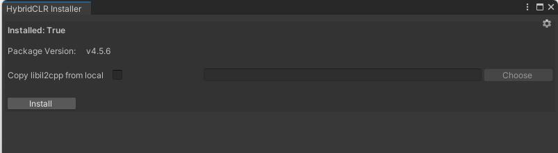
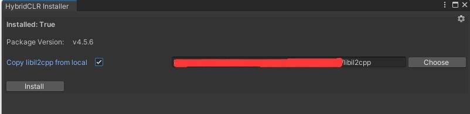

# hybridclr Package Manual

`com.code-philosophy.hybridclr` is a Unity package that provides Editor workflow tools and Runtime scripts required by HybridCLR. With the workflow tools provided by com.code-philosophy.hybridclr, packaging an App that supports HybridCLR hot update functionality becomes very simple. The hybridclr_unity package mainly contains the following content:

- Editor-related scripts
- Runtime-related scripts
- AI Skills, located at `Data~/skills`. See [AI Skills](./ai-skills.md)

:::caution
The package name before v3.0.0 was `com.focus-creative-games.hybridclr_unity`.
:::

:::tip
Starting from **v9.0.0**, the local data directory is fixed at `{project}/Library/HybridCLR` (hot-update dlls, stripped AOT dlls, local il2cpp, and so on). Configurable output-root fields have been removed from Settings.
:::

## HybridCLR Menu Introduction

The following submenus are all under the `HybridCLR` menu in the menu bar. For simplification, we will not include HybridCLR when mentioning submenus below.

### Installer...

For detailed documentation, see [Installing HybridCLR](./install.md).

Installer is a convenient installer that helps correctly set up the local il2cpp directory, including replacing the `Library/HybridCLR/LocalIl2CppData-{platform}/il2cpp/libil2cpp` directory with the HybridCLR modified version.


The installation interface shows `Installation Status: Installed|Not Installed` indicating whether HybridCLR initialization is complete. Click install, and if successful, it will display an `Installation Successful` log and the installation status will switch to `Installed`; otherwise please check the error logs.

:::tip
If HybridCLR is already installed, clicking the install button will install the latest HybridCLR version of libil2cpp.
:::

The `Data~/hybridclr_version.json` file in com.code-philosophy.hybridclr already configures the compatible hybridclr and il2cpp_plus **tags** for the current package version. The Installer installs the versions specified in that configuration and no longer supports choosing arbitrary versions in the UI.

The configuration looks like this:

```json
{
    "versions": [
    {
        "unity_version":"2022.3.x",
        "hybridclr" : { "tag":"v9.0.1"},
        "il2cpp_plus": { "tag":"v2022.3.x-9.0.1"}
    },
    {
        "unity_version":"6000.0.x",
        "hybridclr" : { "tag":"v9.0.1"},
        "il2cpp_plus": { "tag":"v6000.0.x-9.0.1"}
    }
    ]
}
```

If you must install other versions of hybridclr or il2cpp_plus, change the `tag` fields in this configuration file to the target tag or branch name.



Starting from v2.3.1, you can also install by copying a local libil2cpp directory that already contains HybridCLR. If the network is poor or git is unavailable, download [il2cpp_plus](https://github.com/focus-creative-games/il2cpp_plus) and [hybridclr](https://github.com/focus-creative-games/hybridclr) locally, merge them into a libil2cpp tree as described in the **Installation Principle** section of [Installing HybridCLR](./install.md), enable `Copy libil2cpp from local` in the Installer UI, select that directory, and click `Install`.



### Settings...

Opens the HybridCLR Settings page in Project Settings. Field details are in [HybridCLR Settings](#hybridclr-settings) below.

### CompileDll

For each target, you must use hot-update dlls compiled under that target's compilation switches; otherwise hot-update code will not match the AOT player or hot-update assets.

Use the `HybridCLR/CompileDll/...` menu for the active or a specific platform, or call `HybridCLR.Editor.Commands.CompileDllCommand.CompileDll(BuildTarget target)` from code.
Compiled hot-update dlls are written to `{project}/Library/HybridCLR/HotUpdateDlls/{target}`.

### Generate

Generate contains the generation commands needed before packaging.

### Generate/LinkXml

Scans AOT types referenced by hot-update dlls and generates link.xml so those types and members are not stripped. The output path is `outputLinkFile` in Settings (default `HybridCLR/Generate/link.xml`). Preserve granularity is controlled by `linkPreserveLevel`.

For more on stripping, see [Code Stripping Principles and Solutions](../build/codestriping.md).

### Generate/MethodBridgeAndReversePInvokeWrapper

Generates method bridges and ReversePInvokeWrappers together. See [Method Bridge](../build/methodbridge.md) and [MonoPInvokeCallback Support](../features/monopinvokecallback.md).

Generation depends on stripped AOT dlls and hot-update dlls. If you are not using `HybridCLR/Generate/All`, run these in order:

- `HybridCLR/Generate/Il2CppDef`
- `HybridCLR/Generate/LinkXml` (also compiles hot-update dlls for the active target)
- `HybridCLR/Generate/StrippedAotDlls`
- `HybridCLR/Generate/MethodBridgeAndReversePInvokeWrapper`

### Generate/AOTGenericReference

Scans the current hot-update dlls for AOT generic type and method instantiations and writes a **heuristic** file `AOTGenericReferences.cs`.
Converting every scanned generic into a real code reference is awkward, so all instantiation lines are **commented**.

`AOTGenericReferences.cs` also lists assemblies that should receive supplementary metadata, similar to the following, so you can see what to patch without running the game:

```csharp
	// {{ AOT assemblies
	// Main.dll
	// System.Core.dll
	// UnityEngine.CoreModule.dll
	// mscorlib.dll
	// }}
```


Add real instantiation references in other files, because this output is overwritten on every regeneration.
The file is only a hint about which AOT generics you may want to instantiate.
See [AOT Generics](../build/aotgeneric.md) for details.

:::tip
With supplementary metadata, **doing nothing** still runs correctly. Manually instantiating a few performance-sensitive generics such as `Dictionary<int,int>` can improve performance.
:::

Convert the commented entries into real AOT references as needed (**optional; you may skip this entirely or only handle part of them**). For example:

```csharp

    // System.Collections.Generics.List`1<System.Object>.ctor
    new List<object>();

    // System.Byte[] Array.Empty`1<System.Byte>()
    Array.Empty<byte>();

```

### Generate/Il2CppDef

HybridCLR must work across multiple Unity versions and needs macros for the current editor. `Generate/Il2CppDef` writes those macros and related code, similar to:

```cpp
// hybridclr/generated/UnityVersion.h

#define HYBRIDCLR_UNITY_VERSION 2022322
#define HYBRIDCLR_UNITY_2022 1
#define HYBRIDCLR_UNITY_2022_OR_NEW 1
```

### Generate/StrippedAotDlls

Generates stripped AOT dlls by exporting a temporary project, and writes them to `{project}/Library/HybridCLR/AssembliesPostIl2CppStrip/{target}`.
This depends on `Generate/LinkXml` and `Generate/Il2CppDef`. If you are not using `HybridCLR/Generate/All`, run:

- `HybridCLR/Generate/Il2CppDef`
- `HybridCLR/Generate/LinkXml`
- `HybridCLR/Generate/StrippedAotDlls`

### Generate/All

Runs the required pre-build generation steps in order: compile hot-update dlls, Il2CppDef, LinkXml, empty MethodBridge/ReversePInvokeWrapper, StrippedAotDlls, full MethodBridgeAndReversePInvokeWrapper, and AOTGenericReference.

## HybridCLR Settings

Open Project Settings → HybridCLR Settings via `HybridCLR/Settings...`. Field details follow.

### enable

Whether HybridCLR hot update is enabled. Default `true`. When `false`, the player build does not include HybridCLR.

:::caution
If you disable HybridCLR, also remove references to the HybridCLR.Runtime assembly from the main project; otherwise the player build may fail with missing symbols such as `RuntimeApi::LoadMetadataForAOTAssembly`.
:::

### useGlobalIl2cpp

Whether to use the il2cpp directory under the Unity Editor installation. Default `false`. Usually only WebGL builds need `useGlobalIl2cpp=true`.

Even when `useGlobalIl2cpp=true`, Installer still copies il2cpp into `Library/HybridCLR`. Before the first global replace, run `HybridCLR/Generate/Il2CppDef` to generate version macros, then replace the Editor installation's `libil2cpp` with `{project}/Library/HybridCLR/LocalIl2CppData-{platform}/il2cpp/libil2cpp`.
Each `HybridCLR/Generate/*` command still writes to the local directory; you must copy that tree over the global install yourself after generate.

### hybridclrRepoURL

URL of the hybridclr repository. Default `https://gitee.com/focus-creative-games/hybridclr`. Installer clones from this URL.

### il2cppPlusRepoURL

URL of the il2cpp_plus repository. Default `https://gitee.com/focus-creative-games/il2cpp_plus`. Installer clones from this URL.

### hotUpdateAssemblyDefinitions

Hot-update modules listed as assembly definition (asmdef) assets. Equivalent to `hotUpdateAssemblies`, but dragging asmdefs in the Inspector is safer than typing names.

:::caution
`hotUpdateAssemblyDefinitions` and `hotUpdateAssemblies` are merged into the final hot-update dll list. Do not list the same assembly in both.
:::

### hotUpdateAssemblies

Assemblies that exist only as dlls, such as an externally built hot-update dll or `Assembly-CSharp` used as hot-update code. Without an asmdef, configure them by name.
Do not include the `.dll` suffix; use names like `Main` or `Assembly-CSharp`. Asmdef assemblies may also be listed here instead of in `hotUpdateAssemblyDefinitions` if you prefer.

`hotUpdateAssemblyDefinitions` and `hotUpdateAssemblies` are merged into the final hot-update dll list. Do not list the same assembly in both.

### preserveHotUpdateAssemblies

Reserved hot-update dll names for assemblies you plan to add later and want attachable to assets. Putting those names in `hotUpdateAssemblies` before the assemblies exist causes validation errors.
`preserveHotUpdateAssemblies` skips existence checks at build time and still adds the names to files such as `ScriptingAssemblies.json`.
Do not include the `.dll` suffix.

### externalHotUpdateAssembliyDirs

Search paths for externally built hot-update dlls, so you do not have to copy them into the Unity project every time.

:::note
The Settings field name is `externalHotUpdateAssembliyDirs` (spelled that way in the package).
:::

- Paths are searched in order; earlier entries win.
- Paths must be relative to the project root (the parent of `Assets`). For example `mydir` searches `{proj}/mydir`.
- For each path `dir`, the tool first tries `{dir}/{platform}`, then `{dir}`.

Example: an external dll at `{proj}/MyDir1/MyDir2/Foo.dll` requires:

- `Foo` in `hotUpdateAssemblies`
- `MyDir1/Mydir2` in `externalHotUpdateAssembliyDirs`

### linkPreserveLevel

Preserve granularity when running `HybridCLR/Generate/LinkXml`. Default `PreserveAllOfDeclaringType`.

| Value | Meaning |
| --- | --- |
| `PreserveAllOfDeclaringType` | Preserve the entire declaring type of each referenced type. Safer for later hot updates that touch other members; may increase player size |
| `PreserveExactMember` | Preserve only the fields, methods, properties, and events actually referenced by hot-update code. Smaller player; later hot updates may miss unpreserved members |

### outputLinkFile

Output path for `HybridCLR/Generate/LinkXml`. Default `HybridCLR/Generate/link.xml`.

:::caution
Do not point this at `Assets/link.xml`. That file is usually for hand-written preserves; the generated link.xml is overwritten every run.
:::

### outputAOTGenericReferenceFile

Output path for `HybridCLR/Generate/AOTGenericReference`. Default `HybridCLR/Generate/AOTGenericReferences.cs`.

### maxGenericReferenceIteration

Iteration count when recursively analyzing AOT generic instantiations during `HybridCLR/Generate/AOTGenericReference`.

Generic methods may introduce more generics, so multiple iterations are needed. Values around 10 are usually enough. Watch the log to see when iteration stops; raise the value if many generics remain unresolved.

The tool does not iterate forever because some patterns never terminate, for example:

```csharp

    struct AOT<A>
    {

        public void Show()
        {
            var a = new AOT<AOT<A>>();
            a.Show();
        }
    }

```

### maxMethodBridgeGenericIteration

Iteration count when recursively analyzing AOT generics during `HybridCLR/Generate/MethodBridgeAndReversePInvokeWrapper`. Same idea as `maxGenericReferenceIteration`.

## Fixed output directories

These paths are fixed by the package and are no longer Settings fields:

| Content | Path |
| --- | --- |
| Hot-update dlls | `{project}/Library/HybridCLR/HotUpdateDlls/{target}` |
| Stripped AOT dlls | `{project}/Library/HybridCLR/AssembliesPostIl2CppStrip/{target}` |
| Local il2cpp | `{project}/Library/HybridCLR/LocalIl2CppData-{platform}/il2cpp` |

In code, use APIs such as `HybridCLR.Editor.SettingsUtil.HybridCLRDataDir` to resolve the root directory.

## Build Pipeline Scripts

Main responsibilities:

- Check and fix settings
- Exclude hot-update assemblies from the player build
- Add hot-update dll names to the scripting assembly list
- Back up stripped AOT dlls

### Check and fix settings

Part of the build workflow, implemented in `Editor/BuildProcessors/CheckSettings.cs`:

- Sets or clears the process environment variable `UNITY_IL2CPP_PATH` according to HybridCLR settings. Only the current Editor process is affected.
- Switches `Scripting Backend` to `il2cpp` (not required for WebGL).
- Errors if HybridCLRSettings lists no hot-update assemblies.

### Exclude hot-update assemblies from the player build

Part of the build workflow, implemented in `Editor/BuildProcessors/FilterHotFixAssemblies.cs`.

Hot-update assemblies must not be processed by il2cpp into the final player. The `IFilterBuildAssemblies` callback removes them from the build assembly list and also checks for wrong or duplicated names.

### Add hot-update dll names to the assembly list

Part of the build workflow, implemented in `Editor/BuildProcessors/PatchScriptingAssemblyList.cs`.

At build time, hot-update assembly names are written into the scripting assembly list. Names of assemblies that contain hot-update MonoBehaviour scripts must appear there so Unity's asset system can restore those scripts. See [Hot-update MonoBehaviour](../features/monobehaviour.md).

### Back up stripped AOT dlls

Part of the build workflow, implemented in `Editor/BuildProcessors/CopyStrippedAOTAssemblies.cs`.

When supplementary metadata uses `HomologousImageMode::Consistent`, you need the stripped AOT dlls produced by the player build. Those dlls are copied to `{project}/Library/HybridCLR/AssembliesPostIl2CppStrip/{platform}`. With `HomologousImageMode::SuperSet`, you may use the original AOT dlls instead: simpler workflow, but larger memory and larger supplementary dlls. Choose based on your constraints.

## Runtime Scripts

Classes used at runtime.

### LoadImageErrorCode

Error codes for loading hot-update dlls.

### HomologousImageMode


:::tip

Prefer SuperSet for new projects. Switch to Consistent when you need to save memory.

:::

Two modes are supported.

#### `HomologousImageMode::Consistent`

The supplementary dll must match the stripped dll from the player build exactly. Use the stripped dlls produced during build; do not copy the original unstripped dlls. `HybridCLR.BuildProcessors.CopyStrippedAOTAssemblies` copies them to `{project}/Library/HybridCLR/AssembliesPostIl2CppStrip/{target}` during packaging.

#### `HomologousImageMode::SuperSet`

Consistent requires an exact match with the stripped dll. Stripped AOT dlls from `Generate/All` often differ slightly from the real player build and then fail to load. SuperSet only requires that the types and methods needed for supplementary metadata exist.

Relaxed matching needs more metadata bookkeeping and uses more memory.

### RuntimeApi

Low-level HybridCLR helpers. Common APIs:

- `LoadImageErrorCode LoadMetadataForAOTAssembly(byte[] dllBytes, HomologousImageMode mode)` loads a supplementary-metadata assembly.
- `PreJitMethod` / `PreJitClass` pre-compile interpreter methods to reduce first-run cost.
- `GetInterpreterThreadObjectStackSize` / `SetInterpreterThreadObjectStackSize` and related runtime option accessors.

### ReversePInvokeWrapperGenerationAttribute

Scripting stacks such as xlua require `[MonoPInvokeCallback]` on C# methods registered from native code so each method can expose a C++ function pointer. HybridCLR can register hot-update C# with those stacks, but the matching C++ stub wrappers must be generated ahead of time. See [MonoPInvokeCallback Support](../features/monopinvokecallback.md) and [HybridCLR + lua/js/python](../features/workwithscriptlanguage.md).

Each `[MonoPInvokeCallback]` method needs one unique wrapper. Wrappers are fixed at player-build time. If a later hot update adds more `[MonoPInvokeCallback]` methods, you may run out of wrappers. `ReversePInvokeWrapperGenerationAttribute` reserves extra wrappers for a signature. The example below reserves 10 wrappers for `LuaFunction`:

```csharp
    [UnmanagedFunctionPointer(CallingConvention.Cdecl)]
    delegate int LuaFunction(IntPtr luaState);

    public class MonoPInvokeWrapperPreserves
    {
        [ReversePInvokeWrapperGeneration(10)]
        [MonoPInvokeCallback(typeof(LuaFunction))]
        public static int LuaCallback(IntPtr luaState)
        {
            return 0;
        }

        [MonoPInvokeCallback(typeof(Func<int, int, int>))]
        public static int Sum(int a, int b)
        {
            return a + b;
        }

        [MonoPInvokeCallback(typeof(Func<int, int, int>))]
        public static int Sum2(int a, int b)
        {
            return a + b;
        }

        [MonoPInvokeCallback(typeof(Func<int>))]
        public static int Sum3()
        {
            return 0;
        }
    }
```
